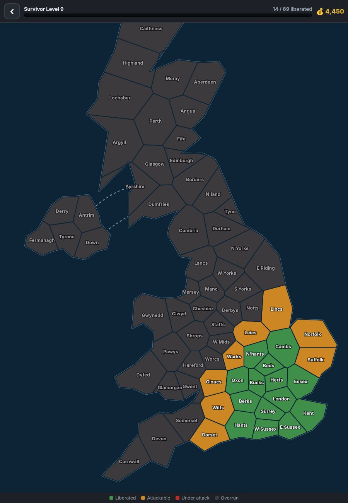

## What it is

Zombie Nation is an auto-shooter for Android in the style of Vampire Survivors, set in a zombie-overrun United Kingdom. You move with a floating thumb-stick and your weapons fire on their own. Zombies drop XP gems, and each level-up offers a new weapon, a passive or an upgrade. Survive the waves, kill the horde boss, and that county is liberated.

The British setting runs through everything. You fight with a Cricket Bat, Pub Darts, a Stinking Bishop cheese aura and a Garden Gnome turret. Max out the Pub Darts with a Lucky Horseshoe and they evolve into **One Hundred and Eighty!** Bosses come from British folklore, including Black Shuck, Spring-heeled Jack, the Lambton Worm and the Green Knight.

## Why I built it

<!-- TODO: Write this in your own words. Why a UK setting, and why a phone game? -->

## A map of the UK, built from a list of points

The campaign is a map of 69 counties and regions. You can start anywhere, but after that you can only attack a county that borders one you've already freed. Each new county has one more wave than the last, up to 20.

I didn't draw 69 county shapes. Each county is just a latitude and longitude. When the map loads, the game builds a **Voronoi diagram** from those points. It starts with each landmass's coastline and clips it against the line halfway between that county and every other county, using Sutherland–Hodgman polygon clipping. What's left is the county's shape.

Borders come from the same geometry: two counties are neighbours if their shapes share an edge longer than a couple of pixels. A short list of blocked pairs fixes places where the geometry disagrees with real geography, and ferry routes link Northern Ireland to Scotland. The whole map builder is about 100 lines.

## Every county plays differently

- **Local hordes.** Each region has its own zombie: Market Traders lobbing fruit in the cities, kilted Highland Berserkers, tunnelling Pit Miners in the North, charging Zombie Rams in Wales, seagull flocks in the South West, and circling Morris Dancer troupes in the South East.
- **County traits.** Each county also has one twist, such as sea fret (fog), Blackout (torchlight only), Restless Graves that erupt around you, peat bogs that slow you down, or thunderstorms with lightning you can see coming.
- **Escalating threats.** From wave 3, a new modifier joins every couple of waves, and they stack: Armoured, Sprinters, Regenerating, Splitters, Volatile and more.
- **Mid-wave objectives.** These include escorting an ambulance to hospital, holding a zone, grabbing supply drops before looters do, and chasing down a golden Wanted zombie.

Zombie health scales with both your campaign progress and the current wave, so the twentieth county is far tougher than the first.

## Pixel art written as text

The sprites are written as text, not drawn in an art program. Each survivor, zombie and companion is a grid of characters in the code. `k` is the outline, `S` is skin, `B` is clothing, and so on. Each grid is painted onto an off-screen canvas once and cached. Walk cycles share the upper-body rows and swap between two sets of leg rows.

The music is generated the same way. A small sequencer plays three chiptune tracks with WebAudio: a 76 BPM menu theme, a 132 BPM battle track and a 160 BPM boss theme. The sound effects are generated too, so the game has no audio files.

## A web game in an Android app

The game itself is plain HTML5 canvas and JavaScript with no build step. You can open `index.html` in a desktop browser and play with WASD. On Android, a single `MainActivity` hosts it in a full-screen WebView with no extra libraries. A small JavaScript bridge stores saves in SharedPreferences and triggers vibration on hits and level-ups.

GitHub Actions builds an APK on every push and signs it with a permanent key stored in repository secrets. Each build gets a higher version number and is published on the Releases page, so new versions install over the old one without losing your save.

## Ten days of features

The first commit was on 1 November, and by 10 November the game had grown to include:
- survivor skill trees
- 18 boss relics
- New Game+ ("The Second Rising")
- seasonal events, triggered by the phone's date (Halloween, Bonfire Night, Christmas and Easter)
- weapon mastery, pet training and 19 tiered achievements
- companions, including a Welsh dragon, a Royal Corgi and Count Batula the vampire bat

## Built with Claude Code

<!-- TODO: The commit history shows the game was built in Claude Code sessions. Say as much or as little as you like: how you worked with it, what you designed versus what it wrote, what surprised you. Delete this section if you'd rather not mention it. -->

## What's next

<!-- TODO: Plans? For example, a Play Store release, more regions or folklore bosses, or balance changes. -->
